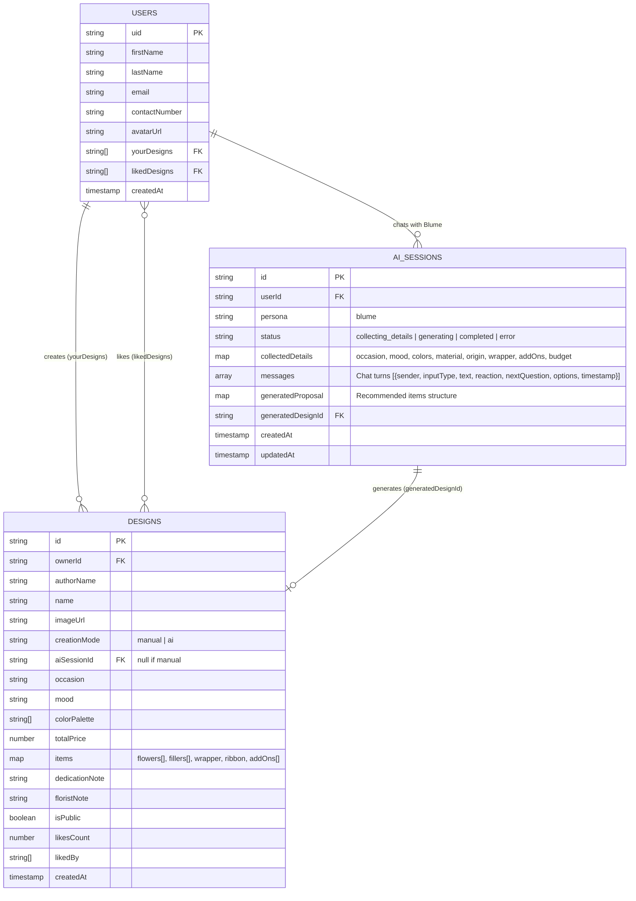

# Fleur de Lis — Application & Firestore Database Schema

## 1. Entity-Relationship / Domain Overview



---

## 2. `users` Collection (`/users/{uid}`)
Powers Authentication, Profile, **Your Designs**, and **Liked Designs**.

| Field | Type | Description |
| :--- | :--- | :--- |
| `firstName` | `string` | User's first name |
| `lastName` | `string` | User's last name |
| `email` | `string` | Normalized email address |
| `contactNumber` | `string \| null` | User's phone/contact number |
| `avatarUrl` | `string \| null` | Optional profile image URL |
| `yourDesigns` | `string[]` | Array of `designId`s created by this user (Manual or AI) |
| `likedDesigns` | `string[]` | Array of `designId`s liked by this user from the Feed |
| `createdAt` | `Timestamp` | Account creation timestamp |

---

## 3. Manual Customization Schema (`designs` with `creationMode: "manual"`)
**Path:** `/designs/{designId}`  
When a user builds a bouquet in **Manual Customization**, they step through selecting **Flowers**, **Fillers**, **Wrapper**, **Ribbon**, and optional **Add-ons**. The resulting document is saved to `designs` (and its ID is added to `users/{uid}.yourDesigns`).

### Manual Customization JSON Structure
```json
{
  "id": "design_manual_001",
  "ownerId": "user_001",
  "authorName": "Ryona Honrado",
  "name": "Golden Graduation Sunflower Bouquet",
  "imageUrl": "/src/assets/images/build-bouquet-sample.jpg",
  "creationMode": "manual",
  "aiSessionId": null,
  "occasion": "Graduation",
  "mood": "Cheerful",
  "colorPalette": ["Yellow", "Cream", "Champagne Gold"],
  "totalPrice": 1110,
  "items": {
    "flowers": [
      {
        "itemId": "flw_006",
        "name": "Fuzzy Wire Sunflower",
        "type": { "material": "fuzzy_wires", "origin": "local" },
        "color": "Yellow",
        "unitPrice": 120,
        "quantity": 3,
        "subtotal": 360
      }
    ],
    "fillers": [
      {
        "itemId": "fil_003",
        "name": "Dried Bunny Tails",
        "type": { "material": "dried", "origin": "local" },
        "color": "Cream",
        "quantity": 2
      }
    ],
    "wrapper": {
      "itemId": "wrp_001",
      "name": "Korean Matte Kraft Paper",
      "type": "paper",
      "color": "Cream"
    },
    "ribbon": {
      "itemId": "rib_002",
      "type": "Sheer Organza Ribbon",
      "color": "Champagne Gold"
    },
    "addOns": [
      {
        "itemId": "add_002",
        "name": "Medium Stuffed Toy",
        "type": "stuffed_toy",
        "selectedOption": "10-inch Graduation Teddy Bear",
        "price": 400,
        "quantity": 1
      },
      {
        "itemId": "add_004",
        "name": "Chocolates",
        "type": "chocolate",
        "selectedOption": "Ferrero Rocher (8 pcs)",
        "price": 350,
        "quantity": 1
      }
    ]
  },
  "dedicationNote": "Congratulations on your graduation!",
  "floristNote": "Place the graduation bear in the center surrounded by the 3 sunflowers.",
  "isPublic": true,
  "likesCount": 0,
  "likedBy": [],
  "createdAt": "2026-11-14T08:30:00Z"
}
```

---

## 4. AI Customization Schema (`ai_sessions` + `designs` with `creationMode: "ai"`)
**Path:** `/ai_sessions/{sessionId}`  
Models the **Blume AI Assistant** workflow from your Sequence Diagram:
1. Starts a conversation (`startConversation()`).
2. Loops `[until details are complete]`, recording whether the user tapped an option (`inputType: "option"`) or typed text (`inputType: "text"`), along with Blume's `reaction` and `nextQuestion`.
3. Produces a `generatedProposal` matching the exact `items` schema of Manual Customization so it can be previewed and saved directly into `/designs/{designId}` with `creationMode: "ai"`.

### AI Customization (`ai_sessions`) JSON Structure
```json
{
  "id": "session_ai_001",
  "userId": "user_001",
  "persona": "blume",
  "status": "completed",
  "collectedDetails": {
    "occasion": "Anniversary",
    "mood": "Romantic",
    "preferredColors": ["Pink", "White"],
    "flowerMaterial": "fresh",
    "flowerOrigin": "imported",
    "wrapperType": "paper",
    "ribbonColor": "Blush Pink",
    "addOns": ["Chocolates"],
    "budgetMax": 1500
  },
  "messages": [
    {
      "id": "msg_1",
      "sender": "blume",
      "inputType": null,
      "reaction": "Hi! I'm Blume, your AI florist assistant.",
      "nextQuestion": "What special occasion are we designing a bouquet for today?",
      "options": ["Anniversary", "Birthday", "Valentine's Day", "Graduation"],
      "timestamp": "2026-11-14T08:40:00Z"
    },
    {
      "id": "msg_2",
      "sender": "user",
      "inputType": "option",
      "text": "Anniversary",
      "timestamp": "2026-11-14T08:40:10Z"
    },
    {
      "id": "msg_3",
      "sender": "blume",
      "inputType": null,
      "reaction": "An anniversary bouquet—how sweet!",
      "nextQuestion": "What mood and flower type would your partner love?",
      "options": ["Romantic (Fresh Roses)", "Rustic (Dried Flowers)", "Playful (Fuzzy Wires)"],
      "timestamp": "2026-11-14T08:40:12Z"
    },
    {
      "id": "msg_4",
      "sender": "user",
      "inputType": "text",
      "text": "Romantic with imported pink roses and Ferrero chocolates",
      "timestamp": "2026-11-14T08:40:30Z"
    }
  ],
  "generatedProposal": {
    "name": "Blume's Romantic Pink Rose Anniversary Bouquet",
    "occasion": "Anniversary",
    "mood": "Romantic",
    "colorPalette": ["Pink", "White", "Cream"],
    "totalPrice": 1250,
    "items": {
      "flowers": [
        {
          "itemId": "flw_001",
          "name": "Ecuadorian Pink Rose",
          "type": { "material": "fresh", "origin": "imported" },
          "color": "Pink",
          "unitPrice": 150,
          "quantity": 6,
          "subtotal": 900
        }
      ],
      "fillers": [
        {
          "itemId": "fil_001",
          "name": "Baby's Breath",
          "type": { "material": "fresh", "origin": "local" },
          "color": "White",
          "quantity": 2
        }
      ],
      "wrapper": {
        "itemId": "wrp_001",
        "name": "Korean Matte Kraft Paper",
        "type": "paper",
        "color": "Cream"
      },
      "ribbon": {
        "itemId": "rib_001",
        "type": "Double-Faced Satin Ribbon",
        "color": "Blush Pink"
      },
      "addOns": [
        {
          "itemId": "add_004",
          "name": "Chocolates",
          "type": "chocolate",
          "selectedOption": "Ferrero Rocher (8 pcs)",
          "price": 350,
          "quantity": 1
        }
      ]
    }
  },
  "generatedDesignId": "design_ai_105",
  "createdAt": "2026-11-14T08:40:00Z",
  "updatedAt": "2026-11-14T08:41:00Z"
}
```
